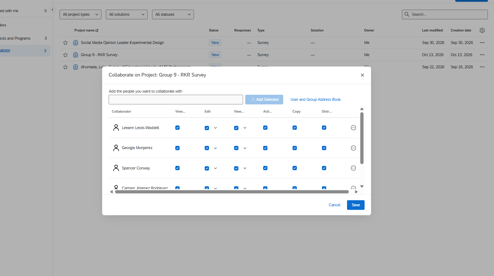
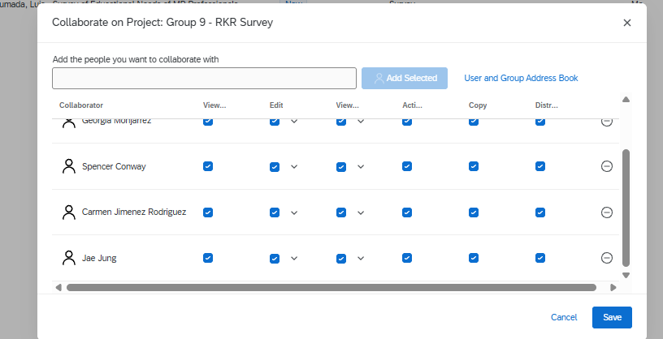

---

---
title: "RKR Survey Questionnaire"
subtitle: "The Restaurant at Kellogg Ranch"
author:
  - name: "Luis Ahumada"
  - name: "Spencer Conway"
  - name: "Carmen Jimenez"
  - name: "Leeann Lewis-Waddell"
  - name: "Georgia Monjarrez"
date: today

format:
  html:
    toc: true
    toc-depth: 2
    theme: cosmo
    embed-resources: true
    smooth-scroll: true

execute:
  echo: false
  warning: false
  message: false
---

## 1. Word Questionnaire

[View RKR Word Questionnaire](https://docs.google.com/document/d/1AoocGBs81NCCCytLAIVy1jOGr37Iu8VcndQgWe3t6ng/edit?usp=sharing)

## 2. Qualtrics Survey

[View RKR Qualtrics Survey](https://cpp.az1.qualtrics.com/jfe/form/SV_es9ZxgONLR7w6PA)

## 3. Qualtrics Survey Sharing Confirmation

{width="551"}

{width="519"}

## 4. Construct and Measurement Table

[View Most Recent C&M Table](https://docs.google.com/document/d/18pAkUMMlKlEJ6Zw8SHTT-p0Pv_SuHBniApEgzvq0Zuc/edit?usp=sharing)

## Appendix

[Git Repo](https://github.com/lahumada63/CEP-05---Questionnaire-Design.git)

[Git Pages](https://lahumada63.github.io/CEP-05---Questionnaire-Design/)
